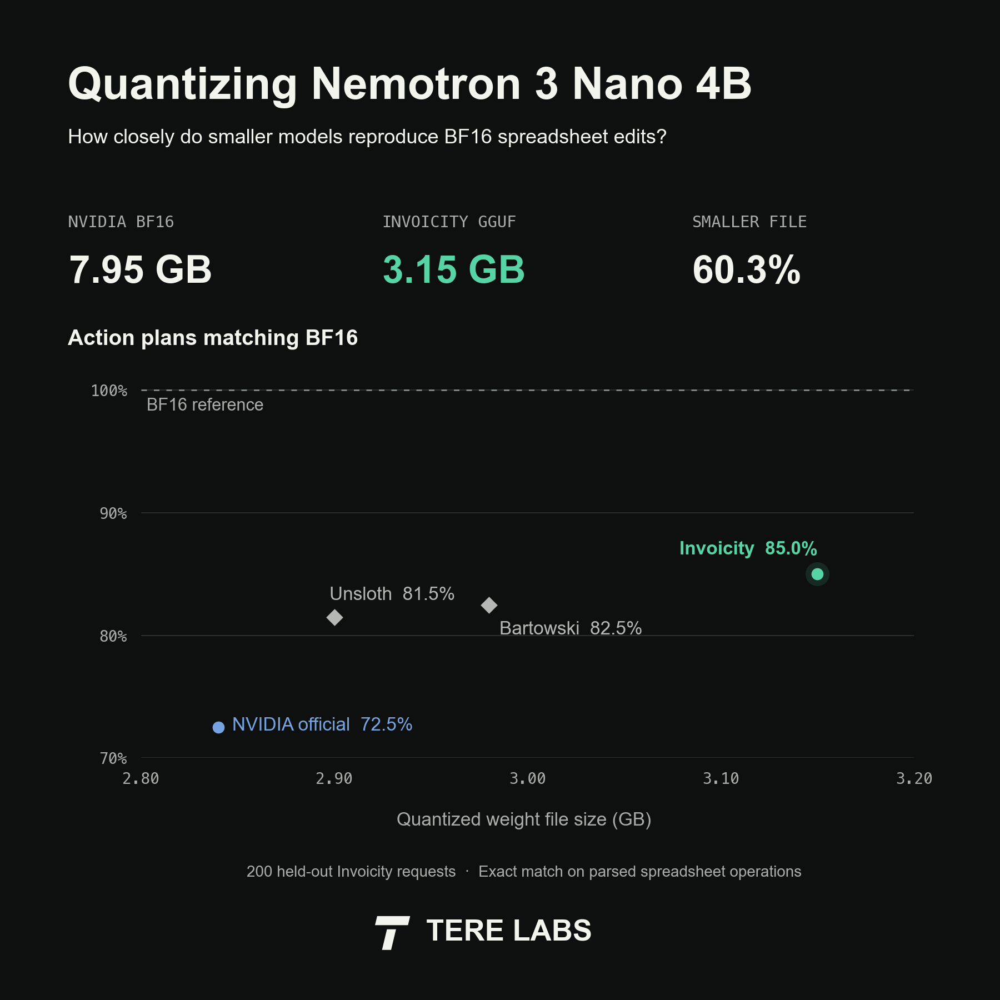

# Invoicity

Invoicity is a free, local AI finance assistant for spreadsheets. Give it a transaction report, ask for a weekly revenue breakdown, and inspect the numbers and formulas in an editable workbook. The desktop app includes the models for chat, vision, and dictation, so your finance team can work offline.

[Download Invoicity](https://invoicity.org/) · [GitHub Releases](https://github.com/m9ter1a/invoicity/releases)

## Install the desktop app

| Platform | How to install |
| --- | --- |
| macOS on Apple Silicon | Open the `.pkg` installer, then launch Invoicity from Applications. The app has an ad hoc signature. |
| Windows x64 | Extract the entire ZIP archive, then open `Invoicity.exe` inside the extracted folder. |
| Ubuntu 24.04 x64 | In the download directory, run `sudo apt install ./invoicity_0.1.12_amd64.deb`, then open Invoicity from the applications menu. Adjust the filename for other versions. |

The finance model uses Metal on Apple Silicon and runs on the CPU on Windows and Linux. The team selected it for machines with 16 GB of memory. The 0.1 builds are intended for internal testing.

## Try a revenue report

1. Choose **Get started**, then **New spreadsheet**. To work with an existing workbook, choose **Import a file**. The optional first-run tour shows where to create, import, search, and bookmark workbooks.
2. Attach a small PDF that lists transaction dates, regions, and amounts. In **Invoicity Agent**, type “Build a table of weekly revenue by region from this PDF. Add a total for each week.”
3. Check the resulting cells and expand the change details under the reply. Select a total and ask “Which transactions make up this number?” To try a simple edit in a blank workbook, ask “Write 42 into D2.”
4. Choose **Export** to save the report. CSV and TSV export the active sheet. The other export formats include the whole workbook.

To dictate a request, click the microphone in the chat. The language picker defaults to **Auto-detect**. Select **English**, **German**, **Spanish**, or **French** to set the recognition language for each phrase. The app remembers your choice and inserts the original-language transcript into your draft. Local speech recognition adds the words to your draft. After two seconds of silence following speech, the app sends the request. Click the recording indicator before then to stop and edit the draft yourself.

## Workbooks and attachments

The Univer editor supports multiple sheets, formulas, range selection, clipboard paste, row and column resizing, sorting, filters, formatting, merged cells, undo, and redo. The workspace keeps a searchable history and bookmarks. It starts in light mode and remembers your theme preference.

| Operation | Supported formats |
| --- | --- |
| Import a spreadsheet | XLSX, XLS, XLSB, ODS, CSV, TSV |
| Export a workbook | XLSX, XLS, ODS, DOCX, PDF |
| Export the active sheet | CSV, TSV |
| Attach to a chat | Up to two text files, spreadsheets, Word documents (DOCX), PDFs, or images per request |

The agent can write values and formulas, change sheet structure, format ranges, sort, and filter. It checks the sheet state before applying edits. Choose **Review this invoice** to check for formula errors, inconsistent line-item totals, missing invoice details, and duplicate invoice numbers for a supplier. Macros, pivot tables, and charts are outside the scope of 0.1, and complex workbooks may look different after export.

The app extracts embedded PDF text directly. For scanned documents and images, it uses Apple Vision on macOS and local Tesseract OCR with English and Russian language data on Windows and Linux. It reads up to the first 30 PDF pages and marks partial extracts. Each request can include up to 9,200 characters of cell data and 6,000 characters per attachment. Select the relevant cells when asking about a large workbook.

## Privacy and chat memory

Workbooks and chat histories are saved in the `books` folder inside Electron’s per-user `userData` directory. Invoicity writes files atomically and requests owner-only file permissions. The files contain plain text, so protection at rest depends on the user account and disk settings.

When you send a message, the app captures the visible spreadsheet area. SmolVLM describes it locally. Nemotron receives that description, a map of fill colors for up to 32 × 32 visible cells, workbook data, and the current selection. The model server listens on `127.0.0.1` and uses a random session key. The app blocks external network requests from the interface, loads the model on first use, and stops it when the app closes.

Each workbook has its own chat. Under **Chat context**, you can compress the conversation into a Nemotron summary or clear it entirely. Both actions require confirmation. Subsequent requests use the summary and recent messages within an 8,200-character history budget. To remove a workbook and its chat, click the trash icon in the workspace and confirm. Invoicity moves the local copy to the system trash and preserves the file you originally imported.

## Under the hood: the Invoicity quantization

Invoicity ships **Tere Labs’ Q4_K_M GGUF** of NVIDIA Nemotron 3 Nano 4B. Its weights take up **3.15 GB**, down from **7.95 GB** for NVIDIA’s BF16 weights. In Tere Labs’ published evaluation of 200 held-out Invoicity requests, the local model produced the same spreadsheet operations as BF16 **170 times (85%)**.



| Model | Weight file size | Action plans matching BF16 |
| --- | ---: | ---: |
| NVIDIA Nemotron 3 Nano 4B (BF16) | 7.95 GB | Reference |
| NVIDIA official Q4_K_M | 2.84 GB | 72.5% |
| Unsloth Q4_K_M | 2.90 GB | 81.5% |
| Bartowski Q4_K_M | 2.98 GB | 82.5% |
| **Tere Labs Invoicity Q4_K_M** | **3.15 GB** | **85.0%** |

**What counts as a match?** Tere Labs ran the same 200 prompts through each model with llama.cpp b12611, reasoning off, temperature zero, and JSON output. Invoicity’s parser converted each reply into spreadsheet operations. A match means those operations were identical to BF16’s for that prompt. This measures agreement with the reference model. File sizes are decimal GB for the weights alone. The published model card provides aggregate results. It does not include the prompt set or per-request outputs needed to reproduce the agreement rates.

**How the quant was built.** Tere Labs calibrated an importance matrix on 1,416 chunks of 512 tokens each. About two thirds came from Invoicity prompts, synthetic finance workbooks, and BF16 replies. The rest came from WikiText. The quant keeps Mamba output and attention projections at Q8_0 and uses the Q4_K_M mix elsewhere. It matched BF16 on 25 more requests than NVIDIA’s official Q4_K_M, with similar CPU throughput in the published eight-thread benchmark.

The app pins the model revision and SHA-256 checksum in its [model manifest](src/finance-model.json) and verifies the weights when packaging. The distribution includes the NVIDIA Nemotron Open Model License. NVIDIA lists English as the supported language. Dictation language support is separate from the finance model’s supported language.

[Quantized weights and benchmark methodology](https://huggingface.co/terelabs/Nemotron-3-Nano-4B-Invoicity-GGUF/blob/ea20ae36c4da16810157c128858db0e00cd13362/README.md) · [NVIDIA BF16 weights](https://huggingface.co/nvidia/NVIDIA-Nemotron-3-Nano-4B-BF16/tree/main)

## Vision and dictation models

- **Spreadsheet vision:** SmolVLM-500M-Instruct describes the editor screenshot. Its weights and vision projector together occupy about 520 MiB. [Vision model](https://huggingface.co/ggml-org/SmolVLM-500M-Instruct-GGUF)
- **Voice input:** Multilingual Whisper Base transcribes microphone input locally through whisper.cpp.

## Build from source

Install Node.js 24 or later, npm, curl, tar, CMake, and a C++ toolchain. On macOS, install the Apple Command Line Tools as well. The preparation step downloads the pinned runtimes and model weights and builds the local speech engine. Run these commands from the repository root on your target platform:

```sh
npm ci
node scripts/prepare-target.mjs
npm test
npm start
```

To package and test the desktop app after preparation:

```sh
npm run package
node tests/platform.mjs
```

On headless Linux, run the platform check with `xvfb-run -a node tests/platform.mjs`. To produce a downloadable archive or Debian package, run `python3 scripts/distribute.py TARGET` with `darwin`, `win32`, or `linux`. The output and its SHA-256 checksum are written to `release/downloads/`.

For cross-packaging on a Mac, first run `node scripts/prepare-voice.mjs` on the target OS and copy the resulting `vendor/voice-TARGET` directory to the build machine. Pass the same target to both `node scripts/prepare-target.mjs TARGET` and `npm run package -- TARGET`.

### Reassemble a split GitHub release

The website serves a single download. If you use GitHub Releases instead, download every numbered part for your platform and its matching `.sha256` file into the same directory. Replace `NAME` below with the full archive or package filename and list all parts in numeric order.

| Platform | Join the parts (three-part example) | Verify the result |
| --- | --- | --- |
| macOS | `cat NAME.part1 NAME.part2 NAME.part3 > NAME` | `shasum -a 256 -c NAME.sha256` |
| Linux | `cat NAME.part1 NAME.part2 NAME.part3 > NAME` | `sha256sum -c NAME.sha256` |
| Windows (Command Prompt) | `copy /b NAME.part1+NAME.part2+NAME.part3 NAME` | Run `certutil -hashfile NAME SHA256` and compare its output with `NAME.sha256`. |

Once the checksum matches, follow the installation instructions for your platform above.
